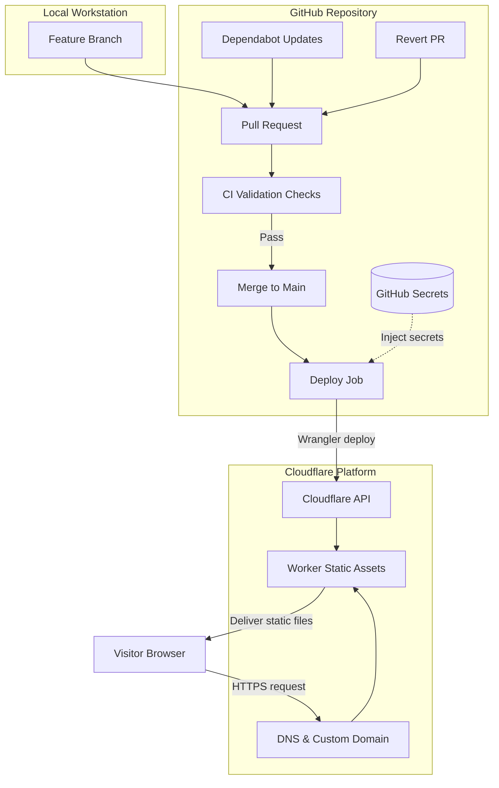

My previous web-development experience dates back to the last millennium: HTML in Notepad, a site on GeoCities, and eventually Macromedia Dreamweaver.

Later, I used ASP for my final-year project: an e-commerce site. That was about it.

Fast-forward to this website. I wanted a résumé, a blog, and somewhere to put my projects. I also wanted to learn how modern development and deployment tools fit together.

I could have started with a template and stopped there. Instead, I decided to experiment with automated checks, deployment credentials, and a way to undo a bad update.

The website was supposed to be simple. The learning project had other ideas.

This post explains the setup I chose, what I am trying to automate, and what still needs testing.

A quick note: I relied heavily on Google, AI assistants and r/webdev for explanations and troubleshooting. This is a learning project, and the setup will change as I understand the tools better. I have separated completed work from checks and tests that are still planned.

 
## 1. What I Wanted to Build 
Before choosing the tools, I set a few core goals:

- **Keep the site lightweight**

- **Track changes clearly** 

- **Automate routine checks**

- **Isolate credentials**

- **Ensure clear recovery**   

The guiding principle was **simplicity**: a small website with a publishing process I could understand. 
  
## 2. The Tools and Their Roles 
I selected the following tools for the project: 
| Component | Tool | Purpose | Reality |
| :--- | :--- | :--- | :--- |
| **Version control** | Git | Track source changes | A record of what I changed before it broke |
| **Code hosting** | GitHub | Store the repository and manage pull requests | Where my code lives and Dependabot nags me |
| **Development runtime** | Node.js | Run development tools and the build process | Having fun fixing npm vulnerabilities for Lighthouse CI :) |
| **Website framework** | Astro | Generate static pages | A good fit for the content-focused site I wanted |
| **Editor** | VS Code | Edit code and content | Yeah, I finally upgraded from Notepad |
| **Formatting** | Prettier | Keep formatting consistent | A pretty code formatter |
| **Deployment tooling** | Wrangler | Upload the generated site and manage deployment | Another tool I had to learn before publishing |
| **Hosting** | Cloudflare Workers Static Assets | Serve the published files | Was considering Pages but I am good boy and listen to Cloudflare recommendation |
| **Automation** | GitHub Actions | Run checks and deployment jobs | Single source of truth to test, build, and run `wrangler deploy` |
| **Dependency updates** | Dependabot | Propose dependency updates through pull req | Hopefully I don’t break it again |

I chose Astro because the website is primarily about content. Static generation allows the pages to be created during the build process rather than generated separately for every visitor.

In this workflow, Astro builds the website, and Wrangler deploys the generated files to Cloudflare. Node.js supports the development and build tools; it is not a server that visitors need to interact with to read the static pages.

Cloudflare Workers Builds connects the validation and deployment stages. Dependabot supports maintenance by proposing dependency updates for review.

I wanted a few useful safeguards, not a security checklist I did not understand.

Most of these tools were new to me, so I added them one at a time rather than trying to configure everything at once.
  
## 3. How a Change Reaches the Live Site 
  
The intended workflow separates four activities:  
1. Develop the website locally. 
2. Validate proposed changes. 
3. Publish an accepted change. 
4. Serve the published files to visitors. 

I make changes on a branch and test them locally before pushing them to GitHub. A pull request then triggers the configured automated checks.

Once the required checks pass, I review the changes and merge the pull request into the main branch.  

A merge to the main branch triggers the production workflow. The intended configuration allows deployment only after the required production checks succeed. 

## Workflow Diagram 
  
The diagram summarizes the intended publishing process and the separate visitor request path. 

  
## 4. Local Setup and Website Configuration

I installed the local tools, created the Astro project, and checked that it ran on my computer. Then I recorded the Node.js version, reviewed the ignore rules, and pushed the starting point to GitHub.

The repository should contain what I need to reproduce the website, not a copy of everything on my computer.

Next came the production URL, static output, page routes, and article schema. The schema defines required fields such as the title and publication date.

I also added draft status. That field needs explicit filtering in the publishing logic so drafts stay out of generated pages, article lists, and feeds. I treat it as an editorial tool, not a place to store confidential information.

The supporting checklist includes a sitemap, RSS feed, custom 404 page, `robots.txt`, favicon, link-preview metadata, and appropriate security headers.

My approach is to verify a manual deployment before relying on automation. That helps separate website and hosting problems from problems in the workflow.  
  
## 5. Automated Checks and Deployment Controls 
One of the main goals was to avoid relying entirely on manual checks before publication.  

I initially considered using both GitHub Actions and Cloudflare Workers Builds. I am now simplifying the plan: GitHub Actions will run the checks, build the site, and deploy it with wrangler deploy.

That gives me one place to manage validation and publishing. The change is still on my to-do list.
  
### Validate proposed changes 
  
My intended checks cover the following areas: 
  
| Check | Purpose |
|---|---|
| Formatting | Catches weird indentation or missing semicolons using Prettier |
| Astro checks | Identify supported code and framework issues |
| Production build | Verifies that static HTML compiles cleanly without errors |
| Link checking | Ensures I haven't linked to dead internal pages |
| Secret scanning | Detect potential credentials in the scanned files or changes |
| Dependency auditing | Scans npm packages for known security vulnerabilities |
 

These checks answer different questions. A successful build does not prove that every link works, every page looks right, or the website has no security issues.

Their usefulness also depends on how they are configured. A link checker only checks its defined scope, and a secret scanner cannot guarantee that it detects every sensitive value. 

I still need to review the content, inspect the generated website, and understand what each check actually covers. 
  
### Control what reaches production 

Where supported by the repository’s GitHub plan and settings, branch protection can require selected checks to pass before a pull request is merged. 

For a solo project, reviewing my own pull request is not independent approval. It is still a useful pause to inspect the changes before publication. 

The intended deployment configuration ties publication to the main branch and makes the deployment job depend on successful production checks. 

### Protect deployment credentials 

Deployment credentials belong in GitHub secrets rather than in the repository.   

Where supported and configured, a production environment can add restrictions around access to those secrets. 

Hardcoding API keys into a public repo is a mistake you only make once. Storing credentials in GitHub Secrets keeps them out of my source code, while scoping the Cloudflare API token limits the damage if a token ever leaks.

Workflow code still requires careful review. A job that receives a secret can potentially misuse it, so secret storage is not a substitute for controlling which code runs with deployment access. 
  
### Review dependency updates 

Dependabot can propose dependency updates through pull requests. My intended process sends those updates through the same relevant checks and review as other changes. 

An automated update proposal is a starting point for review, not proof that an update is safe or compatible. 
  
## 6. Testing Failures and Recovery 

My test plan is to break something small on purpose: remove a required article field, confirm validation fails, fix it, and check that publication works.

Then I want to publish a harmless change and revert it through another pull request.

I would rather practise recovery while I still know exactly what I broke.
  
## 7. What I’m Learning
The most useful part has been understanding how the pieces connect. Editing a page, building it, checking a change, and publishing it are separate jobs.

I do not need every tool available. I need a setup I can explain, maintain, and recover when I make a mistake.

Next comes verifying the remaining checks and recovery tests—and changing the process when it does not behave as expected.

I came here to publish articles. Naturally, I started by building the publishing process.  
