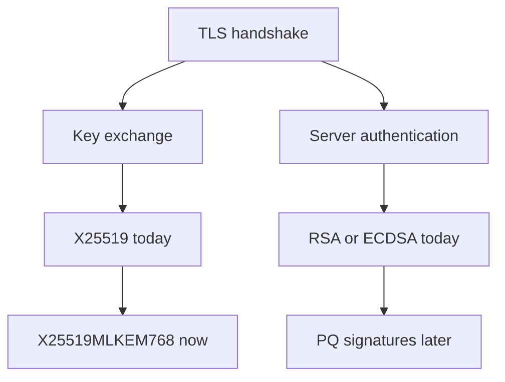
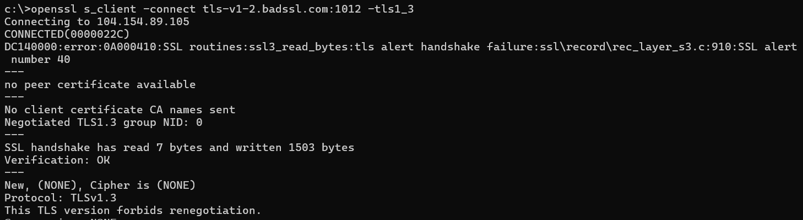
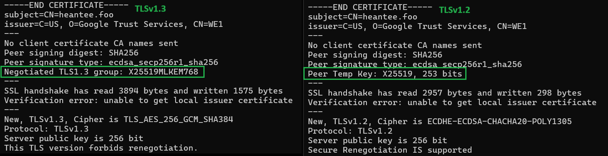

If you mention Post-Quantum Cryptography (PQC) to an IT or security team, someone will usually raise their hand and ask, "Where do we get quantum-safe certificates?" I used to think the exact same thing, mostly because buying a new certificate sounded like an easy box to tick.

Replacing your public TLS (Transport Layer Security) certificate isn't a prerequisite for getting started. The misconception comes from treating a TLS connection as one monolithic block.

In reality, every TLS handshake does two separate security jobs: establishing session keys and authenticating the server. Each one migrates on its own path. Once you split them apart, the migration gets much simpler.

_This information is correct as of 1 November 2026. PQC for TLS is still actively developing, so future updates might supersede this post. I will update this article as standards evolve._

**The short version**

- **Key exchange moves now:** Shift key exchange to post-quantum protection using the hybrid group `X25519MLKEM768` in TLS 1.3.
- **Keep existing certificates:** Your current RSA or ECDSA certificate stays in place for server authentication during this phase.
- **Authentication comes later:** Post-quantum server authentication will follow once the public PKI ecosystem and browser trust stores mature.
- **Immediate action item:** Audit your network to identify endpoints and intermediate appliances that do not yet support TLS 1.3.

## The two tracks of TLS security

Think of a TLS handshake (the opening exchange of the protocol behind HTTPS in your browser) as two tracks running side by side:

1. **Session key establishment (key exchange).** This creates the short-lived secret keys that encrypt the actual data moving back and forth. Traditionally, we use Elliptic-Curve Diffie-Hellman (ECDH) algorithms like X25519. For post-quantum key exchange, NIST standardized the Module-Lattice-Based Key-Encapsulation Mechanism (ML-KEM) in FIPS 203.
2. **Server authentication (signatures).** This proves the server controls the private key behind its digital certificate. A Certificate Authority (CA) vouches that the key belongs to your domain name, so an attacker cannot impersonate the site. Traditionally, this uses RSA or ECDSA signatures in an X.509 certificate. For post-quantum signatures, NIST standardized the Module-Lattice-Based Digital Signature Algorithm (ML-DSA) in FIPS 204.



Why does this distinction matter for your engineering roadmap? Because the threat models for the two tracks are fundamentally different.

Key exchange is vulnerable to "Harvest Now, Decrypt Later" (HNDL). An attacker can record your encrypted traffic today and hold onto it until a quantum computer can break the key exchange years down the road.

Server authentication happens in real time during the active handshake. Recording a session doesn't let an attacker go back and forge a handshake that is already finished. So authentication doesn't have the same harvest-now problem.

That doesn't mean authentication can wait forever. Updating certificates, CAs, and root trust stores can take years, so it carries a long lead time. It simply runs on a different clock.

> **A note on the word "hybrid."** It shows up in two places, and they're different things. A _hybrid key exchange_ (like X25519MLKEM768) combines a classical and a post-quantum key exchange. That's what you can deploy now. A _PQ/T hybrid certificate_ is the term RFC 9794 (an informational IETF document) uses for a certificate that holds both traditional and post-quantum public keys. That belongs to the authentication track and a later phase, and it's optional: DigiCert, for one, recommends ML-DSA-only certificates as the default. A certificate with a single post-quantum key is simply a _post-quantum certificate_, or informally a "PQC certificate."

## Your migration roadmap in four phases

Because key exchange and authentication are independent, you don't need to wait for public CAs to issue PQC certificates before protecting your network traffic.

**Phase 1: Current state (TLS 1.2).** This is an assumed starting point for legacy infrastructure. Your traffic uses classical algorithms: RSA or ECDSA for authentication, and ECDHE for key exchange. That means zero quantum protection, leaving long-lived sensitive traffic exposed to future decryption. Note that running TLS 1.3 with plain X25519 leaves the exact same HNDL gap.

**Phase 2: TLS modernization (TLS 1.3).** Upgrade your servers, load balancers, and reverse proxies from TLS 1.2 to TLS 1.3. This step is mandatory because X25519MLKEM768 is specified exclusively for TLS 1.3, not TLS 1.2. TLS 1.3 isn't PQC by itself, but it is the open doorway.

**Phase 3: Hybrid PQ transition (X25519MLKEM768).** Enable a hybrid key exchange group that combines classical X25519 with post-quantum ML-KEM-768. You keep your existing, trusted RSA or ECDSA certificate. Connections where both client and server support the group gain protection against HNDL. Any client that doesn't support it falls back to classical key exchange, so monitor your traffic to see how much of it actually negotiates the hybrid group.

One practical caveat: the hybrid client key share is 1,216 bytes instead of 32, so the ClientHello (the client's first message) grows by roughly 1,184 bytes. Both the IETF draft and DigiCert highlight these numbers. Test your firewalls, Web Application Firewalls (WAFs), and TLS inspection appliances before a wide rollout.

**Phase 4: Future PQ state (PQ authentication).** Transition server authentication only when the public CA/Browser Forum ecosystem and browser root trust stores fully support it. Two details to keep in mind:

- DigiCert states that the CA/Browser Forum Baseline Requirements do not permit post-quantum algorithms in publicly trusted certificates today. You can, however, test ML-DSA certificates in a private PKI now.
- ML-DSA is the front-runner, but the final public design isn't settled. According to DigiCert, Chrome has named Merkle Tree Certificates (MTCs) as its preferred direction. So Public PQC authentication may end up as something other than plain ML-DSA certificates.

## Lesson from OpenSSL

Let's test this in a terminal. Test 1 points at a public test server (badssl.com). Test 2 points at my own domain. Remember to test only servers you own or that are explicitly meant for testing.

**Test 1: Does the server support TLS 1.3?**

```text
openssl s_client -connect tls-v1-2.badssl.com:1012 -tls1_3
```

The `-tls1_3` flag forces OpenSSL offer TLS 1.3 only, with no fallback. On success, you'll see lines like `New, TLSv1.3, Cipher is TLS_AES_256_GCM_SHA384`. The cipher can differ.

Because this endpoint is configured for TLS 1.2 only, so a TLS 1.3 request gets turned away immediately. The server slams the door, and OpenSSL reports it without any sugarcoating:

```text
DC140000:error:0A000410:SSL routines:ssl3_read_bytes:tls alert handshake failure:ssl\record\rec_layer_s3.c:910:SSL alert number 40
---
no peer certificate available
---
...
New, (NONE), Cipher is (NONE)
Protocol: TLSv1.3
```



The server sent a TLS alert (number 40, handshake failure) and closed the connection. Other servers use other alerts, such as number 70 (protocol version). Two lines tell the real story: `no peer certificate available` and `New, (NONE), Cipher is (NONE)`. No certificate arrived and no session started. The line `Protocol: TLSv1.3` only shows what the client asked for.

This reinforces the core rule: you cannot skip Phase 2. TLS 1.3 is the required foundation for hybrid key exchange, regardless of what certificate you use.

**Test 2: Does it negotiate the hybrid group?**

Requires OpenSSL 3.5 or later. Check with `openssl version`.

```text
openssl s_client -connect heantee.foo:443 -tls1_3
openssl s_client -connect heantee.foo:443 -tls1_2
```



_Left: TLS 1.3. Right: TLS 1.2. Same server, same certificate._

On TLS 1.3, look for `Negotiated TLS1.3 group: X25519MLKEM768`. On TLS 1.2, the matching line is `Peer Temp Key: X25519, 253 bits`. Now look at `Peer signature type: ecdsa_secp256r1_sha256`. It's identical on both sides. The key exchange changed, and the authentication didn't. That's the whole post in one screenshot.

You'll also see `Verification error: unable to get local issuer certificate` in both outputs. That is simply my local terminal missing a local CA trust store, which is unrelated to PQC.

## Next steps for security teams

You don't need to wait for public PQC certificates to start securing your data against future quantum threats.

1. **Audit your endpoints:** Check load balancers, proxies, and security appliances for full TLS 1.3 support.
2. **Engage vendors:** Upgrade your TLS stack and ask vendors of managed products for their ML-KEM support roadmaps.
3. **Pilot early:** Enable `X25519MLKEM768` on a low-risk service first to measure handshake latency and error rates.
4. **Validate middleboxes:** Test firewalls and TLS inspection appliances for handling larger ClientHello packets before widening the rollout.
5. **Experiment in private:** Test PQ certificates in a private PKI while keeping an eye on CA/Browser Forum developments.

Which of your internal systems will be the first you test with hybrid key exchange?

## Sources

- DigiCert, "Recommendations for post-quantum TLS migration" (August 2026): [https\://www\.digicert.com/articles/pqc/recommendations-for-post-quantum-tls-migration](https://www.digicert.com/articles/pqc/recommendations-for-post-quantum-tls-migration)
- IETF Internet-Draft, "Post-quantum hybrid ECDHE-MLKEM Key Agreement for TLSv1.3" (work in progress): [https\://datatracker.ietf.org/doc/draft-ietf-tls-ecdhe-mlkem/](https://datatracker.ietf.org/doc/draft-ietf-tls-ecdhe-mlkem/)
- NIST FIPS 203 (ML-KEM): [https\://csrc.nist.gov/pubs/fips/203/final](https://csrc.nist.gov/pubs/fips/203/final)
- NIST FIPS 204 (ML-DSA): [https\://csrc.nist.gov/pubs/fips/204/final](https://csrc.nist.gov/pubs/fips/204/final)
- IETF RFC 9794, "Terminology for Post-Quantum Traditional Hybrid Schemes": [https\://datatracker.ietf.org/doc/html/rfc9794](https://datatracker.ietf.org/doc/html/rfc9794)
- badssl.com (public TLS test endpoints): [https\://badssl.com/](https://badssl.com/)
