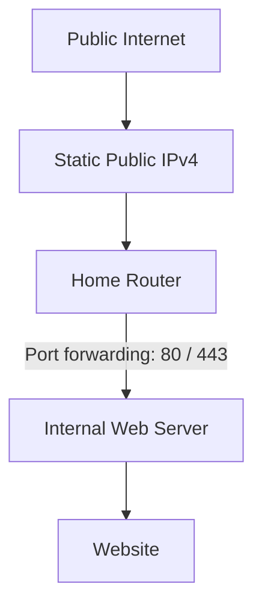
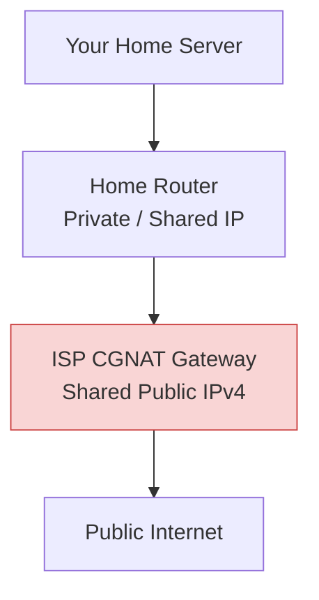
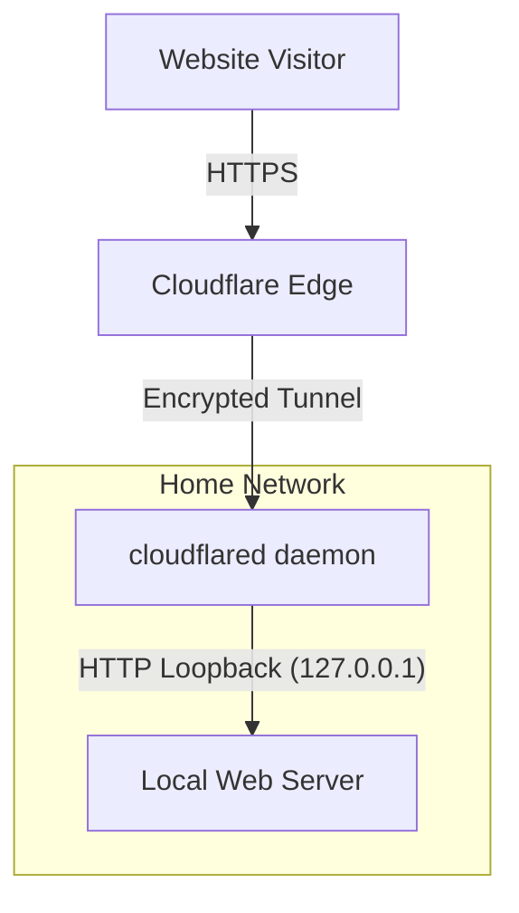

# Do You Still Need a Public IP Address to Self-Host at Home?

> **No. Not necessarily.** A tunnel can publish a home-hosted service without a directly reachable home IP.

## The Blessing of an Unreachable Network

Having an ISP that refuses to provide a publicly reachable IP might actually be a blessing in disguise. My unstable connection is another matter. (If you are wondering, yes, I still receive HealthChecks.io alerts from time to time.)

Recent attacks disrupted refrigeration systems at more than 115 European stores. Attackers changed settings or activated defrost functions. One store reported that its temperature setting had been changed to +50°C, forcing it to discard frozen food. More relevant to a homelab, Synology in November 2026 issued urgent warnings about C3RB3R ransomware targeting exposed NAS devices running outdated DiskStation Manager (DSM) software.

It is a harsh reminder: publishing a service makes it available to attackers as well as visitors. For private services, I would rather avoid a public endpoint.

When I started planning my personal website, my first instinct was to self-host everything from home. Why pay a host when I have hardware sitting right under my desk?

Set up a web server, configure a reverse proxy, fetch a TLS certificate, forward a few router ports, and call it a day. What could possibly go wrong?

Then reality hit: home ISPs drop connections, IP addresses shift, and exposing your local network directly to the public internet turns your living room into a 24/7 security perimeter.

Before opening ports on your router, let's look at how home hosting has evolved, why traditional approaches fail, and how to host safely today.

## Method 1: The Old-School Approach – Static Public IP

The classical way to self-host is requesting a static public IPv4 address from your Internet Service Provider (ISP).

### How it works

Your ISP assigns a fixed, publicly routable IP address to your internet connection. You configure port forwarding on your router to direct incoming traffic to an internal server.

For example:

- TCP port 80 for HTTP.
- TCP port 443 for HTTPS.

The router receives incoming connections and forwards them to the appropriate internal server.

### The security trade-off

A static public IP keeps the address consistent. Firewall rules and exposed services determine what visitors can actually reach.

A reachable service can attract automated scanning, even if the website has very few visitors.

An unpatched web server, an unauthenticated admin portal, or an exposed container can become an entry point. A compromised web VM may then provide a route to other home devices. Separate VLANs and restrictive firewall rules can limit that access.

And that's before someone starts complaining that the home internet is slow because your website is receiving unwanted attention.

## Method 2: DDNS Meets CGNAT – When Things Stop Working

Depending on the ISP and plan, a residential connection may receive a dynamic public IPv4 address rather than a static one.

To keep your domain pointing to the right place, you use Dynamic DNS (DDNS).

### How DDNS works

A DDNS client (running on your router or a server container) periodically checks your current public IP address and updates your DNS record whenever it changes:

1. ISP changes your public IP.
2. DDNS client detects the new IP.
3. Client calls your DNS provider's API to update the A record.
4. Visitors reach the new address after the update and any cached DNS records expire.

DDNS solves IP drift, but it does not bypass firewalls or open ports. And if your home internet connection is already prone to unstable dropouts, relying on DDNS to keep public services live will quickly test your patience.

Then comes the real dealbreaker: CGNAT.

### The CGNAT bottleneck

To stretch their remaining IPv4 pools, many fiber and mobile ISPs now deploy Carrier-Grade Network Address Translation (CGNAT).

Instead of assigning a public IPv4 address to your connection, your ISP shares public IPv4 addresses between multiple customers.

Your router may receive an address from the shared address range `100.64.0.0/10`, defined in RFC 6598, or another non-public address range used by your ISP.

This is different from the private IPv4 ranges defined in RFC 1918, although both are not globally routable.

**Why does this matter?**

You can configure port forwarding on your home router, but you normally cannot configure the ISP's CGNAT gateway. Without a matching mapping or an ISP-supported forwarding mechanism, the gateway cannot deliver unsolicited inbound traffic to your server.

DDNS cannot fix this. It updates your domain to point at the shared public IP, but inbound traffic gets stuck at the ISP's front door.

### What about IPv6?

If your ISP provides globally routable IPv6, you can host over IPv6 without relying on its IPv4 CGNAT gateway.

However, "addressable" does not mean "automatically protected." Routers running IPv6 still rely on firewall rules. With IPv6, check inbound firewall rules directly. Do not assume that the absence of IPv4 port forwarding prevents access.

## Method 3: Cloudflare Tunnel - No Inbound Ports Required

If you are behind CGNAT or want to avoid inbound port forwarding, Cloudflare Tunnel offers another option.

Instead of accepting incoming connections, your internal server reaches outward to establish a persistent, encrypted tunnel to Cloudflare's network.

This diagram assumes that cloudflared and the web server share the same network namespace, such as running directly inside one VM.
Separate containers normally need container-network addressing rather than 127.0.0.1.

### How it works

1. **Visitor to Cloudflare:** The visitor connects to your public hostname using HTTPS.
2. **Cloudflare to daemon:** Cloudflare routes the request through the outbound tunnel to your running cloudflared instance.
3. **Daemon to local app:** cloudflared forwards the request locally (e.g., to http://127.0.0.1:8080).

The local connection does not automatically use HTTPS. You can configure HTTPS if your application requires it.

### Why I considered it

- **No Inbound Port Forwarding:** I do not need to forward ports 80 or 443 on my router.
- **Works Behind CGNAT and Dynamic IPs:** The tunnel does not require a directly reachable or fixed home IP address.
- **Hides Origin IP:** Public DNS records point to Cloudflare rather than publishing my home IP.
- **Free Edge Protection:** Cloudflare provides edge DDoS protection and plan-dependent WAF features. The Free plan includes a limited managed ruleset.

It still depends on my home power, internet connection, and home lab server. An outage can make the application unavailable until connectivity returns.

### The Caveat

Cloudflare Tunnel secures the transit path, but it does not fix vulnerabilities inside your application. Access policies can restrict who reaches a private application. They do not replace application updates or secure configuration.

## The Shift: Public Hosting vs. Private Remote Access

When building a homelab, it helps to divide your goals into two distinct categories:

### 1. Public websites: Let someone else handle the hosting

For my personal website, I decided that running a home server was not worth the maintenance and uptime requirements. And for my site, I ended up using Astro paired with Cloudflare Workers Static Assets.

It keeps the origin server off my home network entirely. I do not have to worry about power outages, ISP instability, or keeping a local web server patched. The site lives on Cloudflare's global edge, while my homelab stays private.

### 2. Private remote access: Use an Overlay VPN

What if you want to check your Proxmox dashboard, access Home Assistant, or manage a personal NAS while away from home?

For my homelab, I would keep these interfaces on a private overlay network rather than publish them through a public hostname.

Tailscale, built on WireGuard, is one option for this private overlay network. It attempts direct encrypted connections between devices using NAT traversal. When direct connections fail, it can use encrypted relays. It usually works without manual router port forwarding.

Don't worry, I will cover Tailscale and my configuration in a separate post.

## Baseline Security: Hardening Your Home Network

Whether you host a public web demo via Cloudflare Tunnel or manage private containers via Tailscale, these baseline rules reduce common risks:

### Network & Router Controls

- [ ] Close All Inbound WAN Ports: Disable unnecessary port-forwarding rules.
- [ ] Disable UPnP: Universal Plug and Play lets local devices open router ports automatically. Turn it off.
- [ ] Disable Remote Management: Keep your router's administration GUI strictly inaccessible from the WAN side.
- [ ] Segment Your Network: Isolate experimental servers and VMs on dedicated VLANs away from primary home devices.

### Service & Access Controls

- [ ] Restrict Admin UI Access: Keep hypervisors (Proxmox, ESXi) and storage portals (NAS) strictly inside a private VPN overlay like Tailscale.
- [ ] Enforce Authentication: Place public-facing tunnels behind Cloudflare Access or identity-based access policies. Apply this to private services, not necessarily the public website.
- [ ] Automate Backups: Keep isolated, offsite backups of your homelab configurations and data.

## Conclusion: Expose Only What Is Necessary

Having a static public IP is not inherently bad. Direct home hosting can work, but I would need to maintain the server, control inbound access, and accept the uptime limits.

For this website, I chose Astro with Cloudflare Workers Static Assets. Cloudflare serves the deployed files, so visitors do not depend on my home server or connection.

Private remote access is a separate requirement. I would keep homelab administration on a private overlay network rather than publish those interfaces through public hostnames.

CGNAT makes ordinary inbound IPv4 hosting harder. It does not replace firewall rules, security updates, or access controls.

**The takeaway:** You do not need to expose your home network just because you want to access something remotely or publish a website. Choose the architecture that fits the service, keep the attack surface small, and expose only what you actually need.

---

## Further Reading

1. [Synology warns of C3RB3R ransomware attacks targeting NAS devices – BleepingComputer](https://www.bleepingcomputer.com/news/security/synology-warns-customers-of-ongoing-c3rb3r-ransomware-attacks/)
2. [Hackers disrupt refrigeration systems at European supermarkets](https://www.bleepingcomputer.com/news/security/hackers-disrupt-refrigeration-systems-at-european-supermarkets/)
3. [RFC 6598 – IANA-Reserved IPv4 Prefix for Shared Address Space](https://www.rfc-editor.org/rfc/rfc6598)
4. [Cloudflare Tunnel Documentation](https://developers.cloudflare.com/tunnel/)
5. [Cloudflare Workers Static Assets](https://developers.cloudflare.com/workers/static-assets/)
6. [Tailscale – Subnet Routers](https://tailscale.com/docs/features/subnet-routers)
7. [Tailscale – Firewall Ports](https://tailscale.com/docs/reference/faq/firewall-ports)
8. [Cyber Security Agency of Singapore – How to Protect Your Router from Hackers](https://www.csa.gov.sg/alerts-and-advisories/advisories/ad-2024-021/)
