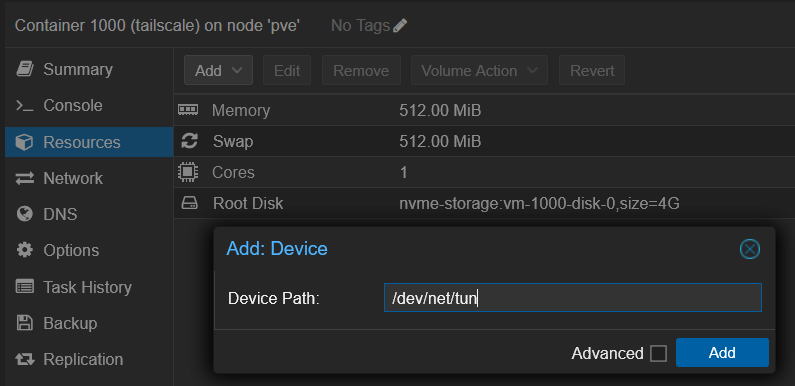
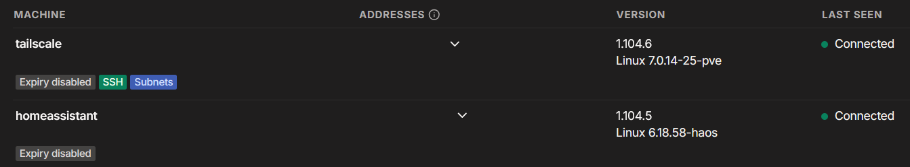
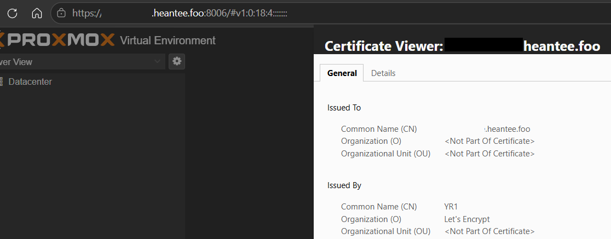
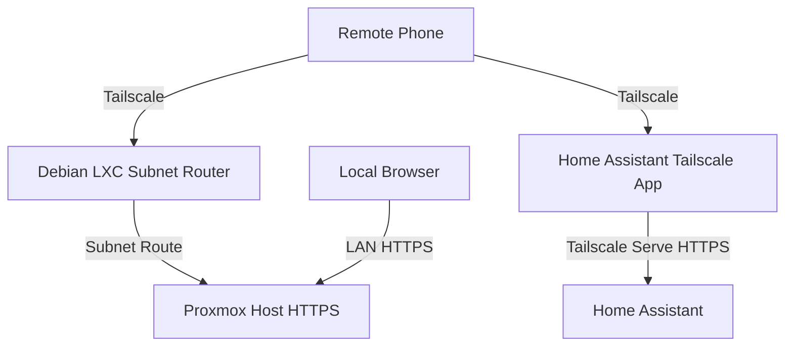

Wouldn't it be cool to check on your homelab while you're away from home? Confirm the services are running, see that last night's backup completed, or let a family member control some home automation from their phone.

That's what I wanted. But exposing the management interface of Proxmox, the hypervisor that runs my homelab, directly to the public internet is essentially inviting the entire web to try your lock. Opening router ports was a non-starter.

In my previous post, [Do You Still Need a Public IP Address to Self-Host at Home?](https://heantee.foo/blog/do-you-need-public-ip-address/), I looked at whether you need a public IP address to self-host at home. This post is the practical follow-up for remote access. The short version: I use Tailscale to reach Proxmox and Home Assistant from anywhere, with no inbound ports open on my home router. One small Debian container handles Proxmox. Home Assistant gets its own separate connection.

Here is how the pieces fit together, why I chose an unprivileged LXC container (a lightweight Linux container that shares the host's kernel), and what I still need to improve.

## My current setup

Here is a quick overview of my environment:

| Component                    | Configuration                                                  |
| ---------------------------- | -------------------------------------------------------------- |
| Proxmox                      | Proxmox VE 9.x                                                 |
| Tailscale container          | Standard Debian 13, unprivileged LXC                           |
| Container networking         | `/dev/net/tun` device passthrough                              |
| Container role               | Subnet router for the LAN containing Proxmox                   |
| Home Assistant               | Separate Tailscale app with Serve enabled                      |
| Home Assistant subnet routes | None advertised                                                |
| Proxmox HTTPS                | Built-in ACME client, Cloudflare integration and Let's Encrypt |
| Public access                | No inbound port forwarding or public endpoint configured       |
| Access restrictions          | Custom least-privilege policy planned                          |

## What is Tailscale?

Tailscale connects devices through a private network called a _tailnet_. It uses WireGuard, a modern VPN protocol, to encrypt traffic between devices.

It tries to connect devices directly. When it can't, encrypted traffic travels through a relay. The relay can't decrypt it.

For my homelab, the most useful feature is subnet routing. A subnet router gives access to a whole local network, including devices that don't have Tailscale installed.

That means I can install Tailscale in one dedicated container and reach Proxmox through its existing LAN IP address. I don't need to install anything on the Proxmox host itself.

### A subnet router is not an exit node

These are easy to confuse, but they serve different purposes.

| Function         | Purpose                                           |
| ---------------- | ------------------------------------------------- |
| Tailscale device | Connects a device directly to the tailnet         |
| Subnet router    | Provides access to an advertised network          |
| Exit node        | Routes internet traffic through a selected device |

My Debian container is a subnet router, not an exit node.

I want to reach my homelab when I'm away from home. I don't need all my phone's internet traffic to travel through my home connection.

## Where should Tailscale run in Proxmox?

There are three common places to run Tailscale in a Proxmox environment:

| Location         | Advantages                                                    | Trade-offs                                                                |
| ---------------- | ------------------------------------------------------------- | ------------------------------------------------------------------------- |
| Proxmox host     | Access does not depend on a guest starting                    | Adds another service directly to the hypervisor                           |
| Unprivileged LXC | Lightweight and keeps the installation separate from the host | Shares the host kernel and needs TUN device access for this configuration |
| Dedicated VM     | Has its own guest kernel and stronger isolation boundary      | Requires more resources and another operating system to maintain          |

I chose an unprivileged LXC container. It keeps Tailscale separate from the Proxmox host without needing a full virtual machine.

An unprivileged container maps its root user to an unprivileged user ID on the host. That limits the host privileges available to processes running as root inside the container.

However, an LXC container is not a VM. It shares the host kernel, and its isolation depends on how it's configured.

There is also an operational trade-off: if the container is unavailable, remote access to Proxmox through that subnet router is unavailable too. Worth remembering when planning maintenance.

## TUN-based networking vs. userspace networking

Before configuring the container, I needed to understand why Tailscale wanted access to `/dev/net/tun`.

In normal Linux operation, Tailscale uses a TUN device to exchange network packets with the operating system. A TUN device is a virtual network interface that lets software send and receive IP packets through the OS network stack.

Tailscale also has a userspace networking mode, which is an alternative when a TUN device is unavailable.

| Mode                 | How it works                                                        | Main consideration                                            |
| -------------------- | ------------------------------------------------------------------- | ------------------------------------------------------------- |
| TUN-based networking | Uses a virtual network interface and kernel-level packet forwarding | Supports normal IP routing and requires `/dev/net/tun` access |
| Userspace networking | Uses a userspace network stack to proxy connections                 | Has different routing behaviour and protocol limitations      |

Userspace networking is useful in restricted container environments. However, it is not simply another implementation of the same routing method. In userspace subnet-router mode, Tailscale proxies TCP and UDP connections instead of forwarding all IP traffic, so some protocols and network behaviours are not supported.

For a Linux subnet router, kernel-mode routing is generally the better choice when the environment allows it.

One clarification: TUN-based networking does not mean Tailscale uses the Linux kernel's native WireGuard implementation. Tailscale's WireGuard implementation runs in userspace. The TUN interface is just the connection to the operating system's network stack.

My container uses TUN-based networking.

## Giving the LXC container access to TUN

Unprivileged LXC containers usually don't have access to `/dev/net/tun` by default.

I followed [Tailscale's official LXC documentation](https://tailscale.com/docs/features/containers/lxc/lxc-unprivileged) to enable device passthrough. In the Proxmox interface:

1. Select the container.
2. Open **Resources**.
3. Select **Add**.
4. Select **Device Passthrough**.
5. Enter `/dev/net/tun` in **Device Path**.
6. Add the device.
7. Shut down the container if it is running.
8. Start the container again.

 Proxmox Device Passthrough dialog with /dev/net/tun entered as the device path

Once the device is available, install the Tailscale Linux package inside the Debian container.

This only provides the TUN device. It does not configure the container as a subnet router.

### Configuring the subnet router

A Linux subnet router needs IP forwarding, advertised routes and route approval.

For example, to enable IPv4 forwarding:

```bash
echo 'net.ipv4.ip_forward = 1' | sudo tee -a /etc/sysctl.d/99-tailscale.conf

sudo sysctl -p /etc/sysctl.d/99-tailscale.conf
```

If your environment uses IPv6 subnet routing, configure IPv6 forwarding as well.

After installing and authenticating Tailscale, advertise the LAN subnet:

```bash
sudo tailscale set --advertise-routes=192.168.1.0/24
```

Replace the example subnet with your actual LAN network.

A few more steps are needed before remote access works:

1. Approve the advertised route in the Tailscale admin console, unless automatic route approval is configured.
2. Make sure remote clients accept the advertised route.
3. Configure access policies to permit the required connections.
4. Check that firewalls allow traffic to reach the destination.
5. Test access from outside the home network.

 Tailscale admin console Machines list showing the Debian container as a connected subnet router

Android, iOS, macOS and Windows clients pick up new subnet routes automatically. Linux clients need route acceptance enabled:

```bash
sudo tailscale set --accept-routes
```

My container advertises the LAN subnet containing Proxmox. That gives me a remote-access path without installing Tailscale on the Proxmox host.

For the full configuration, see [Tailscale's subnet-router documentation](https://tailscale.com/docs/features/subnet-routers).

## Why Home Assistant has its own Tailscale app

You might wonder why I run a second Tailscale instance when I already have a dedicated subnet router.

My Home Assistant runs its own Tailscale app, with Tailscale Serve enabled. This gives me two independent access paths.

There is an operational benefit too. If I stop the Debian LXC container for maintenance, Home Assistant stays reachable through its own Tailscale connection.

In my configuration:

- Tailscale Serve is enabled.
- Home Assistant does not advertise subnet routes.
- I mainly use its MagicDNS hostname for the Home Assistant mobile app.
- Family members who want to control some home automation need to install the Tailscale client on their phones.

Tailscale Serve provides private access to a local service through the tailnet, and handles HTTPS using a tailnet hostname.

It's worth distinguishing Serve from Funnel:

- **[Serve](https://tailscale.com/docs/features/tailscale-serve)** provides access to services within the tailnet.
- **[Funnel](https://tailscale.com/docs/features/tailscale-funnel)** can expose a service to the public internet.

I use Serve, not Funnel. Home Assistant stays on my private Tailscale network.

If you want to compare Funnel with Tailscale's other sharing options, see [Funnel vs. sharing devices](https://tailscale.com/docs/reference/funnel-vs-sharing). It also notes that Funnel doesn't work with Tailscale access controls.

I followed [Tailscale's Home Assistant guide](https://tailscale.com/blog/remotely-access-home-assistant), including the updated installation instructions.

## Addresses, MagicDNS and my custom domain

Names and IP addresses across a homelab get confusing fast. Three things are doing different jobs here:

- **Subnet routing:** Provides network reachability to devices on my LAN.
- **MagicDNS:** Provides DNS names for devices connected directly to my tailnet.
- **Custom domain:** Provides the hostname I use to reach my Proxmox management interface.

One important detail: MagicDNS does not create hostnames for every device behind a subnet router.

Home Assistant has its own Tailscale identity and MagicDNS hostname. Proxmox doesn't. I reach it through the advertised LAN route, using my custom hostname.

A working subnet route doesn't configure DNS. Likewise, working DNS doesn't provide HTTPS. These are separate parts of the setup.

## From browser warnings to trusted HTTPS

Before this setup, I accessed Proxmox through its local IP address and clicked past the browser's certificate warning. It worked, but it wasn't ideal.

I now use a custom hostname with a trusted Let's Encrypt certificate. Proxmox's built-in ACME client (ACME is the protocol Let's Encrypt uses to automate certificates) manages it through the Cloudflare DNS integration.

The DNS-01 challenge lets Let's Encrypt verify that I own the domain by checking a DNS record. Nothing needs to reach my home network on port 80 or 443.

Tailscale and HTTPS solve different problems here. Tailscale protects traffic between Tailscale devices, but with a subnet router, the encrypted tunnel ends at that router. HTTPS adds protection between my browser and the Proxmox web interface. The certificate also lets the browser confirm that the server is trusted for the hostname I'm using.

Installing Tailscale doesn't configure HTTPS for applications behind a subnet router.

When I'm away from home, I connect my phone to Tailscale, resolve my Proxmox hostname through my DNS configuration, and open the management interface over HTTPS.

No more ignoring browser certificate warnings.

 Browser showing the Proxmox hostname with a valid certificate

## What I still need to improve

The remote-access setup works, but I wouldn't call the security configuration complete.

My tailnet currently uses the default access policy. A newly created tailnet lets its devices communicate with one another by default. That's convenient when getting started, but it isn't least privilege.

My next task is tighter access restrictions. I want to review:

- Which users and devices need Proxmox administration.
- Which users and devices need Home Assistant access, such as family members' phones.
- Which destination IP addresses and ports each service requires.
- Which broad permissions I can remove.

Tailscale provides [Access Control Lists (ACLs)](https://tailscale.com/docs/features/access-control/acls) and [Grants](https://tailscale.com/docs/features/access-control/grants) for this. I haven't configured Grants yet. Tailscale's documentation says grants can do everything ACLs can, deny access by default, and are the recommended best practice for most use cases. See also the [grant examples](https://tailscale.com/docs/reference/examples/grants).

I also need to remember that Tailscale access policies control traffic within the tailnet. They don't restrict ordinary LAN access or remove other possible paths to a service.

I'll consider this part done only after I've configured and tested the actual permissions.

## Final thoughts

I now have remote access to my Proxmox homelab without deliberately publishing its management interface to the internet.

Each component has a specific job:

- Tailscale provides private network connectivity.
- The subnet router connects remote devices to my home LAN.
- Home Assistant has an independent remote-access path.
- DNS resolves the hostnames.
- HTTPS protects the application connection.

This is a useful foundation, but not a complete security solution. I still need to tighten the access policies and verify that each device can reach only the services it needs.

The diagram below shows how the two remote-access paths fit together.



There's still work to do, but at least I no longer have to explain to my router why port 8006 should be open to the entire internet. 🙂
