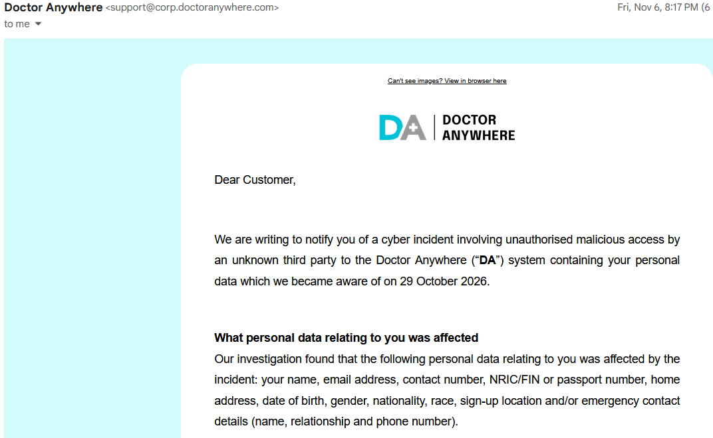
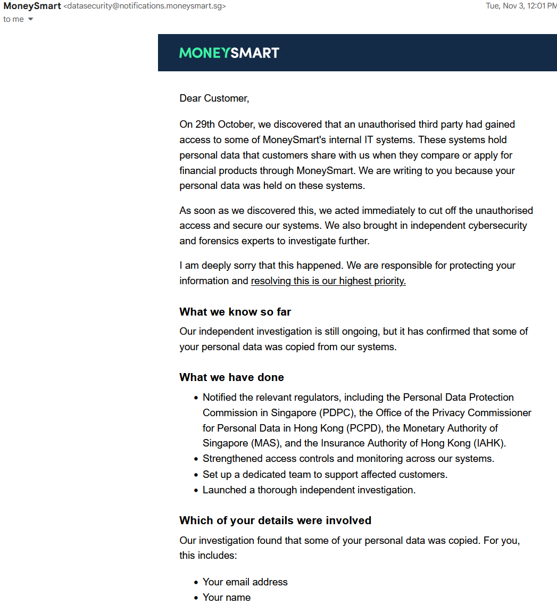

# My Data Was Exposed. What Am I Supposed to Do Now?

There is something unsettling about receiving an email that starts with,
"We are writing to notify you of a cyber incident."

I recently received two such emails: one from Doctor Anywhere and
another from MoneySmart. Both involved my personal information. Both
apologised and advised me to stay vigilant.

But after reading them, I was left wondering: What exactly was exposed?
What should I actually do? And how can I reduce the risk of this
happening again?

The short answer is that you cannot stop companies from getting breached, so your response needs to match the specific type of data leaked, and shift toward limiting what you share in the first place.

I am certainly not alone. Recent reports have described data breaches
involving organisations such as M1, Doctor Anywhere, Fullerton Health
and SPH Media. There was also the incident involving Amadeus, a
technology provider used by Singapore Airlines, where about 46,000
booking records were accessed.

That last incident is a useful reminder: the organisation we give our
information to may not be the only one holding it. A service provider or
business partner may also process or store that information.

The details differ between incidents, but the problem for customers is
similar: information we entrusted to someone else may now be in the
hands of people we never intended to share it with.

## 1. What happened, and what was exposed?

The first thing I learnt was to read the actual list of affected
information instead of stopping at the words "data breach".

 Doctor Anywhere - All my personal details

In the Doctor Anywhere notification I received, the affected information
included my name, email address, contact number, NRIC/FIN or passport
number, home address, date of birth, gender, nationality, race, sign-up
location and/or emergency-contact details.

The company said that, based on its investigation at that time, there
was no evidence that clinical records, passwords, login credentials,
bank account details, payment-card details or images of identity
documents had been compromised.

 MoneySmart - name and email address

MoneySmart's notification was narrower. It confirmed that my name and
email address had been copied. The email also warned that scammers might
use details such as phone numbers or NRIC/FIN numbers to make contact
seem genuine. Those examples were warnings about possible scam tactics,
not confirmation that those additional details had been copied from my
account.

That distinction matters. A breach involving a name and email address is
not the same as one involving passwords, medical records or
identity-document numbers. It is also important to distinguish between
information that was affected, information that was accessed, and
information confirmed to have been copied.

### "No banking details affected" does not mean "nothing to worry about"

It is reassuring when a company says payment information was not
compromised. But personal information can still help criminals create
convincing impersonation attempts.

Imagine receiving a call from someone who knows your full name, address
and the healthcare provider you use. They say they are following up on
the breach and need you to "verify your account".

The details may be accurate. The caller may not be.

Someone knowing your personal information is not proof that they
represent the company, your bank or a government agency. That is the
risk I am most concerned about: not just someone possessing my
information, but using it to persuade me to hand over something more
valuable.

## 2. What should I do now?

"Stay vigilant" is reasonable advice. It is also frustratingly vague.
Here is a more practical way to approach it.

### Verify the notification independently

Before clicking anything in the email, open the company's app or type
its official website address into your browser. Find its support details
there and check whether the notification is genuine.

The same principle applies to follow-up messages. If someone contacts
you about the breach, verify the request independently. Do not use the
phone number or link supplied in an unexpected message as your only
source of truth.

### Work out which information was actually involved

Keep a copy of the notification. Look for answers to these questions:

- Which of my personal details were affected?
- Were they accessed, copied, or is that still being investigated?
- Were passwords or payment details involved?
- Was anyone else's information affected, such as an emergency
  contact's?
- What support is the organisation offering, and where will it publish
  updates?

These questions are particularly useful when a notice uses broad wording
such as "personal information" or lists several fields with "and/or".

### Secure important accounts

A breach notification does not automatically mean every account you own
has been compromised.

If passwords or login credentials were exposed, change them immediately.
If you reused the same password on other services, change it there too.
Use a different password for each important account, especially email
and banking, and enable two-factor authentication (2FA) where available.

Changing a password cannot undo the exposure of an address or date of
birth. Your response should match the information exposed: follow any
account-specific instructions and fix weak security habits rather than
changing passwords indiscriminately.

### Monitor accounts for suspicious activity

Check bank and card statements for transactions you do not recognise, and report suspicious transactions to your bank promptly.

Also watch for unexpected verification codes, password-reset messages or
requests to approve a login. Never share passwords, one-time passwords
(OTPs), Singpass credentials or verification codes with someone who
contacts you unexpectedly.

If another person's information was involved, such as an emergency
contact's details, let them know too. They deserve the same warning
about unexpected calls or messages.

### Know where to get help

If you are unsure whether a call or message is a scam, Singapore's
24-hour ScamShield Helpline is **1799**. You do not have to decide
entirely on your own.

If you have disclosed banking credentials or noticed an unauthorised
transaction, contact your bank immediately through an official channel.
If you have been scammed, make a police report as well.

### A quick checklist

If you have just received a data-breach notification, start here:

- [ ] Verify the notification through the organisation's official
      website or app.
- [ ] Identify exactly which personal information was affected.
- [ ] Change passwords if credentials were exposed or reused
      elsewhere.
- [ ] Enable 2FA on important accounts.
- [ ] Monitor bank statements and important accounts for unusual
      activity.
- [ ] Be cautious of unexpected calls, messages and verification
      requests.
- [ ] Notify anyone else whose information may have been affected.

## 3. What can I do differently in the future?

There is an important limit to personal cybersecurity advice: I cannot
fix a company's vulnerable server from my phone.

What I can do is reduce how much information I expose, improve the
security of my accounts and make it harder for one incident to create
problems elsewhere.

### Use a different password for every important account

At a minimum, email and banking should not share passwords with other
services. If one service suffers a breach, unique passwords stop an attacker from reusing that leaked password elsewhere, a technique known as credential stuffing.

A password manager can help generate and store unique passwords. The aim
is to make this an ongoing habit, rather than a frantic exercise every
time a breach notification arrives.

### Use email aliases to reduce unnecessary exposure

Another habit worth adopting is to stop giving every service the same
email address.

An email alias is an alternative address that forwards messages to your
usual inbox. You can give a service the alias without revealing your
primary email address. If the address starts receiving spam or is
involved in a breach, you can stop using it without changing your main
email address.

Two options worth considering are Apple Hide My Email and Firefox Relay.

**Apple Hide My Email**

If you subscribe to iCloud+, you can use Hide My Email to generate
random email addresses that forward messages to your personal inbox. You
can label addresses, add notes and deactivate ones you no longer need.

On an iPhone, you can manage these addresses under:

`Settings → Your Name → iCloud → Hide My Email`

For example, I could create separate aliases for a newsletter, an online
shop and an app I am trying out, rather than giving all three the same
address.

One caution: deactivating an address stops it forwarding messages.
Before retiring an address associated with an account you still use,
update that account's contact details so you do not miss important
messages.

**Firefox Relay**

Firefox Relay provides email masks that forward messages to your real
inbox. At the time of writing, Mozilla’s help documentation says free Firefox Relay accounts can create up to 5 email masks, while Premium offers unlimited masks.

Mozilla recommends using masks for less critical sign-ups, such as
online shopping, apps and websites you do not fully trust. It advises
against using them where identity verification or reliable delivery is
important, such as banking, healthcare and legal communications. Some
websites may also reject masked addresses.

That makes newsletters, marketing sign-ups and other non-critical
subscriptions a more straightforward starting point than moving every
essential account behind a forwarding service.

### Understand what aliases cannot protect

An email mask protects your underlying email address. It does not
conceal other information you give the same organisation.

If you register with an alias but also provide your real name, NRIC
number, phone number and home address, those details remain with the
service. An alias would not have prevented the wider categories of
exposure described in my Doctor Anywhere notification.

Think of aliases as one useful layer of protection, not an invisibility
cloak.

## Customers should not have to carry the entire burden

There is a danger that every breach ends with the same conclusion:
customers must be more careful.

We should take sensible precautions. But an organisation's
responsibility should not end with an apology and a reminder not to
click suspicious links.

A Straits Times commentary makes this point too, arguing for practical
assistance beyond notification, such as monitoring services, stronger
account safeguards and dedicated help for affected customers. These are
proposed remedies, not guarantees that every affected customer currently
receives them.

For me, a useful response would begin with clarity: tell me exactly what
was affected, explain what remains uncertain, provide meaningful support
and keep me updated.

I can change a password. I can replace an email alias. I cannot simply
replace my date of birth.

That is why a breach notification should be the beginning of a company's
response to its customers, not the end.

---

## Sources and further reading

### Incident reporting

- [CNA: MoneySmart hit by data breach; some customers' data
  copied](https://www.channelnewsasia.com/singapore/moneysmart-data-breach-security-incident-6515356)
- [CNA: Doctor Anywhere and M1 hit by data
  breaches](https://www.channelnewsasia.com/singapore/doctor-anywhere-data-breach-6530871)
- [The Straits Times: Fullerton Health server hit by
  cyberattack](https://www.straitstimes.com/singapore/fullerton-health-server-hit-by-cyberattack-personal-data-of-migrant-workers-affected)
- [CNA: SPH Media cyberattack and data
  breach](https://www.channelnewsasia.com/singapore/sph-media-cyberattack-data-breach-6538681)
- [CNA: About 46,000 SIA booking records accessed in Amadeus
  breach](https://www.channelnewsasia.com/singapore/sia-singapore-airlines-amadeus-data-breach-booking-records-6517151)
- [The Straits Times: Why data breaches are surging in Singapore and
  why firms owe victims more than an
  apology](https://www.straitstimes.com/tech/why-data-breaches-are-surging-in-singapore-and-why-firms-owe-victims-more-than-an-apology)

### Privacy and scam-prevention resources

- [Apple Support: Create and manage Hide My Email
  addresses](https://support.apple.com/en-gb/guide/iphone/iphcb02e76f7/26/ios/26)
- [Mozilla Support: Create an email mask through Firefox
  Relay](https://support.mozilla.org/en-US/kb/create-email-mask-through-firefox-relay)
- [ScamShield: 1799
  Helpline](https://www.scamshield.gov.sg/check-for-scams/scamshield-helpline/)
