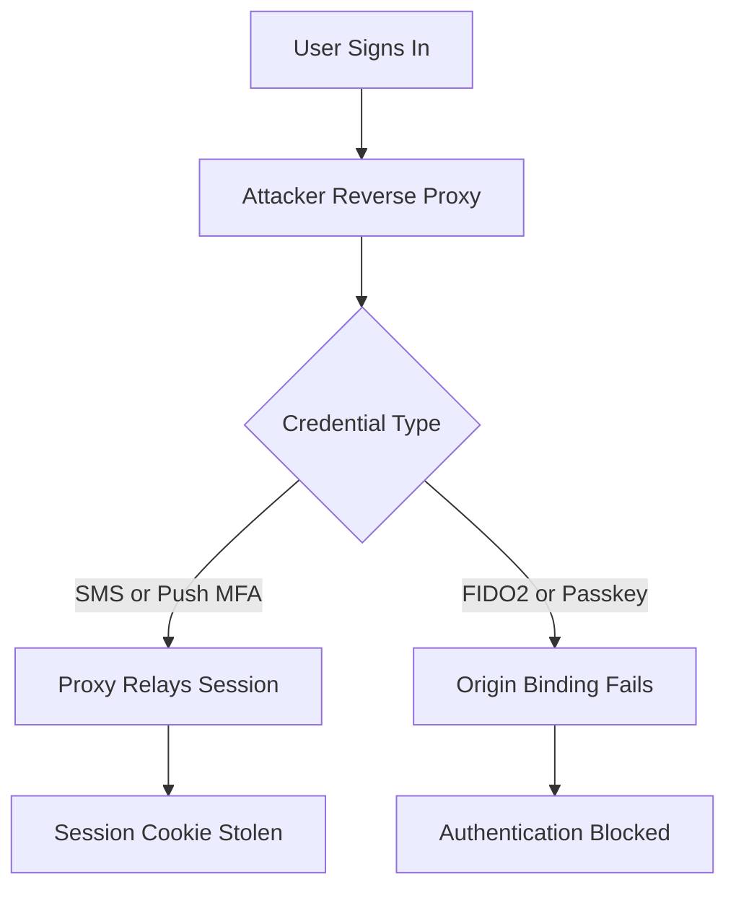

_Originally shared as a LinkedIn article in July 2026, adapted here for `heantee.foo` with updated tables, architecture diagrams, and a downloadable PDF playbook._

Passwords are becoming optional. Phishing resistance isn't.

In July 2026, two major identity shifts set a clear trajectory for both national digital identity and enterprise IAM teams:

- **Singpass (GovTech Singapore):** Singapore's national digital ID, used by 5.5 million residents, began rolling out passkeys on 1 July 2026 to counter the S$39.9 million in phishing losses recorded in 2025 that passwords and one-time passcodes (OTPs) failed to stop.
- **Microsoft Entra ID:** Microsoft announced that passkeys become the default sign-in method from 1 September 2026 (automatically prompting SMS and voice users to register passkeys), with built-in SMS and voice MFA retiring on 1 February 2027.

Two different institutions, one direction: retire phishable authentication and move to origin-bound cryptographic sign-in.

> **Download the Playbook:** Want the 14-slide executive deck for internal architecture reviews? <a href="/downloads/passwordless-phishing-resistant-mfa-v1.0.pdf" data-umami-event="download-mfa-playbook-v1">Download the PDF Playbook (v1.0)</a>.

## Passwordless Does Not Equal Phishing-Resistant

The biggest trap in modern identity migrations is treating "passwordless" and "phishing-resistant" as interchangeable.

Phone push approvals, SMS codes, and email OTPs remove typed passwords, yet Adversary-in-the-Middle (AiTM) reverse-proxy toolkits bypass them daily. When a user signs in through a look-alike proxy domain, the attacker relays credentials and push approvals in real time and captures the resulting authenticated session cookie.

Origin-bound cryptographic credentials such as FIDO2 security keys, passkeys, and Windows Hello for Business bind the cryptographic challenge directly to the legitimate domain. When presented with a spoofed proxy URL, the authenticator refuses to sign the challenge and blocks the session structurally.

## The Authentication Arsenal

Choosing the right authenticator depends on device ownership, privilege level, and operational environment:

| Method                           | Form Factor                   | Phishing-Resistant | Ideal Use Case                                         |
| :------------------------------- | :---------------------------- | :----------------- | :----------------------------------------------------- |
| **FIDO2 Security Key**           | Hardware (USB / NFC)          | Yes                | Privileged admins, break-glass accounts, shared kiosks |
| **Authenticator Passkey**        | Smartphone (BYOD / Corporate) | Yes                | General workforce                                      |
| **Windows Hello for Business**   | Native TPM + Biometric        | Yes                | Managed corporate Windows laptops                      |
| **Certificate-Based Auth (CBA)** | Smart Card / PKI Certificate  | Yes                | Regulated PKI environments                             |
| **Authenticator Push / SMS**     | Mobile App / Telecom          | No                 | Transitional fallback only                             |

## Before the Rollout: Fix Legacy Password Hygiene

You cannot migrate every user to passkeys overnight. While closing the legacy gap, align password policies with **NIST SP 800-63B**:

1. **Enforce continuous breach screening:** Block compromised passwords at creation and sign-in using Entra Password Protection, Specops, or Enzoic.
2. **Prioritize length over complexity:** Require passphrases longer than 15 characters instead of arbitrary symbol rules.
3. **Stop mandatory 90-day resets:** Periodic expiration drives predictable incremental patterns (`Summer2025!` to `Summer2026!`). Reset passwords only on evidence of compromise.

## The 5-Phase Transition Architecture

A safe enterprise rollout sequences user enrollment before policy enforcement:

- **Phase 0 - Baseline and Risk Segmentation:** Inventory authentication methods and segment users into Admin, Remote, Kiosk, and Legacy cohorts.
- **Phase 1 - Eliminate the Weakest MFA:** Deprecate SMS, voice, and email OTPs first. Avoid relying solely on mobile push notifications in regions with restricted push ecosystems.
- **Phase 2 & 3 - Deploy Strong Credentials:** Issue physical FIDO2 keys to admins and kiosk workers, enable Windows Hello for Business across managed Windows endpoints, and roll out device-bound Authenticator passkeys for remote staff.
- **Phase 4 - Context-Aware Conditional Access:** Enforce tiered policies (`CA-PR-Admin` for privileged portals, `CA-PR-SensitiveApps` for Finance/HR/code repositories, `CA-Transition` with a strict sunset date, and `CA-Legacy-Block` to block legacy protocols).
- **Phase 5 - Password Retirement:** Remove password fallback paths once strong credential coverage reaches target thresholds.

### Edge Cases and Rollout Guardrails

- **Shared workstations and factory kiosks:** Issue user-carried physical FIDO2 security keys rather than shared mobile devices.
- **Restricted mobile notification regions (e.g., Mainland China):** Favor local device-bound Authenticator passkeys with TOTP as a temporary fallback, as standard Android push delivery can fail.
- **Emergency break-glass accounts:** Exclude break-glass accounts from Conditional Access policies and secure them with isolated FIDO2 keys stored in a physical vault.
- **Preventing tenant lockouts:** Always complete strong credential registration before flipping Conditional Access policies to enforcement mode, and audit mobile OS readiness (Android 14+ / iOS 17+) beforehand.
- **Hardening helpdesk recovery:** As authentication hardens, attackers target helpdesk identity verification workflows. Enforce strict out-of-band identity proofing for credential resets.

---

_Disclaimer: This is a strategic framework, not a compliance or legal document. Validate all timelines, licensing requirements, and technical controls against your own environment and current vendor documentation before acting on any dates or figures cited._
