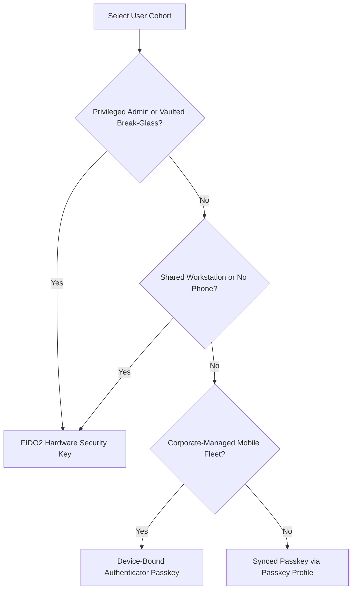

If you missed my [earlier guide on retiring phishable MFA](/blog/passwordless-phishing-resistant-mfa-guide/), here is the short recap: passkeys use public-key cryptography instead of a shared password and are designed to resist phishing. You typically authorise their use with a fingerprint, face scan or local PIN.

Microsoft has also begun making passkeys the default registration experience for users enabled for SMS or voice authentication. Microsoft-provided SMS and voice delivery starts retiring on 1 February 2027 for most users, followed by Global Administrators and external users on 1 July 2027. Organisations that still need these channels can configure a supported third-party telephony provider.

That gives us a direction. It does not tell us which passkey approach fits each user.

This post builds on [Merill Fernando's Entra.Chat conversation with FIDO Alliance CTO Nishant Kaushik](https://entra.news/p/which-passkey-should-your-users-get) (14 November 2026). The three passkey flavours and the hardware key checklist below come from that discussion. How I map them to Entra ID user groups is my own take.

My main takeaway: the decision should not end at successful sign-in. It has to cover what happens when the user loses the thing they sign in with.

## Why "One Passkey Policy for Everyone" Fails

In early IAM pilots, teams often treat passkeys as a binary choice: hand everyone a physical FIDO2 USB key, or let everyone register whatever their browser offers. Both break down at enterprise scale.

Issuing hardware keys to every knowledge worker recreates the headaches of the old hardware token era: procurement, shipping delays, lost keys and helpdesk lockouts. Unrestricted registration has the opposite problem. Your Global Administrators and break-glass accounts (the emergency admin accounts you keep for when normal sign-in fails) could end up on consumer cloud-synced credentials.

Microsoft's rollout makes this more than a thought experiment. Since 1 September 2026, users on SMS and voice MFA have been switched on for passkeys and prompted to register one, unless an admin opted out.

Without passkey profiles or attestation rules in place, those users can register synced passkeys. Passkey profiles let you apply different rules to different groups of users, while attestation is how an authenticator proves what kind of device it is.

Rather than treating this as all-or-nothing, segment your workforce by risk and device ownership.

## The Three Flavours of Workforce Passkeys

Workforce passkeys sit on a spectrum, from **easy lifecycle recovery** at one end to **strict hardware lockdown** at the other:

1. **Synced passkeys (Apple Passwords, Google Password Manager, 1Password, Bitwarden):**
   The private key lives in a consumer or enterprise credential manager and syncs across the user's devices through encrypted cloud backup. If a user drops their phone in a river and buys a new one (don’t laugh, I’ve had users do this before), the passkey may still be available through another device or recoverable through the provider. That can reduce re-registration work, provided the user can regain access to the account holding their passkeys. Recovery has not disappeared; part of it now depends on that provider. That makes synced passkeys a good fit for general staff, contractors and BYOD (bring your own device) users.
2. **Device-bound passkeys on a phone or computer:**
   The credential remains on the device where it was created rather than syncing through a provider. Microsoft Authenticator is one example supported by Entra ID. Device-bound does not automatically mean organisation-managed. You still need to establish who owns the device, what controls apply, and how the user replaces the credential when the device is lost or reset.
3. **Hardware security keys (FIDO2 USB / NFC):**
   Separate security keys are worth considering for privileged access, shared-workstation use, or environments where phones are unavailable or prohibited. Whether they are the right choice depends on compatibility, credential-control requirements and the recovery process. Emergency access accounts need a separate design: the credential must remain available during the failures those accounts are intended to address. If the key is lost, that credential is gone. You need a second registered key or a controlled recovery process to regain access.

| Passkey Flavour                    | Examples                                                       | Key Portability                           | Device Loss Recovery                             | Best Fit                                               |
| :--------------------------------- | :------------------------------------------------------------- | :---------------------------------------- | :----------------------------------------------- | :----------------------------------------------------- |
| **Synced**                         | Apple Passwords, Google Password Manager, 1Password, Bitwarden | Syncs across the user's trusted ecosystem | **Self-service** via cloud account recovery      | General workforce, BYOD, external collaborators        |
| **Device-bound (platform or app)** | Microsoft Authenticator, Windows Hello                         | Tied to one device                        | **IT-assisted** re-registration (e.g., via TAP*) | Managed corporate devices, regulated staff             |
| **Hardware security key**          | FIDO2 USB-A / USB-C / NFC keys                                 | Locked to the physical key                | **Backup key** or identity-verified replacement  | Privileged admins, shared kiosks, break-glass accounts |

_\*TAP = Temporary Access Pass, a time-limited code an admin issues so a user can register a new credential._

_(On corporate-managed Windows laptops, Windows Hello for Business is still my default. It is device-bound, backed by the laptop's built-in TPM security chip, and costs nothing extra in hardware.)_

## A Practical Decision Flow for IAM Teams

When you map user groups to Entra ID passkey profiles, start with privilege level, then check device ownership:

One pragmatic rule, which the episode also touches on: **do not block synced passkeys for standard users if the alternative is leaving them on SMS or push MFA.** A synced passkey is still origin-bound, meaning it will not work on a look-alike domain. That stops Adversary-in-the-Middle (AiTM) phishing kits (which relay a fake login page to the real one) from capturing a sign-in.

Still, it is not a silver bullet. A synced passkey is only as strong as the cloud account behind it, so keep an eye on that recovery path, and decide on any stricter credential rules before users register.

In Entra ID, turning on attestation later does not retrospectively validate or block previously registered unattested credentials. Plan any cleanup or re-registration separately.

## Four Rules Before Issuing Hardware Security Keys

Hardware keys have no cloud backup, so handing them out without a lifecycle plan guarantees helpdesk friction. Settle these four things first:

1. **Buy FIDO Certified hardware:** Stick to keys that are FIDO Certified and meet your Entra ID attestation requirements.
2. **Verify identity strongly at registration:** A cryptographic key is only as trustworthy as the onboarding check behind it. Require in-person verification or strong identity proofing before issuing the TAP for initial key enrolment.
3. **Plan the backup credential up front:** Decide whether high-risk users get **two** hardware keys (primary plus spare, so the second key is a backup, not a weaker fallback) or a tightly governed recovery path, before a lost key becomes an emergency.
4. **Document the replacement workflow:** Write and test the exact helpdesk runbook for revoking a lost or damaged key and enrolling a replacement. You will reuse that process for years.

## Where to Start This Week

Start by checking what users have already registered and which policies apply to them. Then choose one pilot group and test both an ordinary sign-in and a lost-authenticator scenario.

Before broadening the rollout, confirm that your profiles allow what you intend, group overlap does not weaken the restrictions, and support can complete recovery without improvising.

The right passkey is not simply the one that works at registration. It is the one whose enrolment, everyday use and replacement you can support without quietly undoing the security you wanted.
