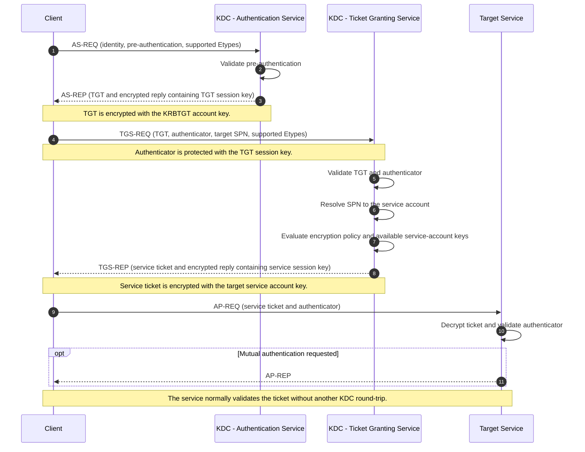

> **Series:** Windows Authentication Hardening (Part 1 of 2)

Updated domain controllers no longer quietly fall back to RC4 when a service account's encryption settings are blank. If an old service account, appliance or keytab depended on that fallback, it may already be failing.

The short version: find out which service accounts actually hold AES keys, and test the applications that rely on them.

I originally shared these notes on LinkedIn on 22 June 2026, a few weeks before Microsoft's July enforcement deadline. The blog came later in October, and this piece has been sitting in my drafts since then. The deadline has passed, but legacy authentication dependencies rarely disappear on schedule, so it is still worth checking who in your environment relies on RC4.

This is the first article in a two-part series on Windows authentication hardening. I will start with Kerberos encryption and the move away from RC4. In Part 2, I will look at Microsoft's NTLM signing changes and the compatibility issues they have exposed in some third-party products.

## Why is Microsoft moving away from RC4?

RC4 is an older encryption cipher that stayed in Windows environments to keep legacy operating systems, applications and network appliances working. That backward compatibility comes with a steep security cost.

The biggest risk is **Kerberoasting**. Any user with a standard domain account can request a Kerberos service ticket for an account tied to a Service Principal Name (SPN, the unique identifier Windows uses to map a service to a login account) and try to crack its password offline. Because RC4 is fast to brute-force, weak service-account passwords become easy targets. Moving to AES, the modern replacement cipher, makes offline cracking dramatically slower, though it does not eliminate Kerberoasting or excuse weak passwords.

Microsoft tracks this hardening under CVE-2026-20833 and rolled it out in three stages:

| Date            | Phase                     | What changed                                                                                                                                                                                                                                          |
| --------------- | ------------------------- | ----------------------------------------------------------------------------------------------------------------------------------------------------------------------------------------------------------------------------------------------------- |
| 13 January 2026 | Initial deployment        | Windows updates added audit events to flag Kerberos service-ticket requests affected by the upcoming hardening.                                                                                                                                       |
| 14 April 2026   | Enforcement with rollback | The Key Distribution Center (KDC, the domain controller service that issues tickets) default changed to AES128 and AES256 (0x18, labeled AES-SHA1 in Microsoft's documentation) for accounts without an explicit msDS-SupportedEncryptionTypes value. |
| July 2026       | Final enforcement         | Windows updates removed the temporary `RC4DefaultDisablementPhase` rollback setting, so the AES-only default can no longer be switched back with it.                                                                                                  |

RC4 has not vanished from every Active Directory domain overnight. Microsoft still honors encryption types set explicitly on an account, so RC4 stays active wherever someone configured it on purpose."

## A quick refresher: how Kerberos authentication works

Before looking at encryption settings, it helps to trace the three exchanges in a Kerberos login:

1. **Authentication Service (AS) exchange:** The client proves its identity to the KDC and receives a Ticket Granting Ticket (TGT).
2. **Ticket Granting Service (TGS) exchange:** The client presents its TGT to request a ticket for a specific application or server.
3. **Application (AP) exchange:** The client hands that service ticket to the target application to log in.

The KDC handles the first two steps. The target application validates the ticket on its own during the final step.

### Kerberos authentication flow

The diagram below is deliberately simplified to show where tickets and session keys come into play. The exact encryption type selected depends on the client request, the account keys in Active Directory and the KDC's policy.

The critical step for this hardening change is the **TGS exchange**. When a client asks for a service ticket, the KDC maps the SPN to an account and checks which encryption types and keys that account actually has.

## Where do the encryption types and keys matter?

Active Directory exposes four encryption values that are easy to confuse:

- **Advertised Etypes:** The encryption types ("etypes") the client says it supports during the current request.
- **`msDS-SupportedEncryptionTypes`:** An Active Directory attribute defining which encryption types are permitted for a specific account.
- **Available Keys:** The cryptographic keys actually stored for that account in the Active Directory database.
- **Session Encryption Type:** The algorithm chosen to protect the temporary session key, as recorded in Kerberos audit logs.

Setting an account attribute to allow AES does not mean the account actually has AES keys. Always check that AES shows up under **Available Keys**.

One caution from Microsoft's documentation: these event fields show processed values, not a raw copy of the attribute. On Windows Server 2022 and earlier domain controllers, `msDS-SupportedEncryptionTypes` can display DES and RC4 whatever you configured, and RC4 appears under Available Keys regardless of usage. Treat the fields as strong clues, not gospel.

Remember too that two separate keys are in play: the **service ticket** is encrypted with the target service account's long-term key, while the **service session key** protects the conversation between client and server. They do not always use the same encryption type.

## What can go wrong in a legacy environment?

Removing the implicit RC4 fallback tends to expose shortcuts that worked quietly for years:

- A legacy operating system, network-attached storage (NAS) box or appliance only supports RC4.
- A service account has AES enabled in its attributes, but no AES keys, because its password has not been rotated since before Windows Server 2008 domain controllers were introduced.
- A non-Windows service relies on an outdated **keytab** (a local file storing exported Kerberos keys) that only contains an RC4 key.
- An SPN is registered on a different account than the one actually running the service, causing decryption failures.
- A third-party Kerberos library or appliance enforces limits that never show up in Active Directory attributes.

Rotating the service account's password generates fresh AES keys, but do not do it blindly. Confirm which account owns the SPN, update any dependent keytabs or application configs and test in staging first. Where supported, migrating to a **group Managed Service Account (gMSA)** lets Windows handle password and key rotation automatically.

> **Watch out for 20-year-old service accounts**: Almost every enterprise environment has at least one legacy account with a non-expiring password that became so critical nobody dares touch it. Those accounts are usually the first to break when RC4 fallback disappears.

## Do not forget KRBTGT and the domain level

Two older issues can also keep RC4 alive:

- **KRBTGT keys.** If the KRBTGT password has not been reset since before your first Server 2008-or-later domain controller was promoted, it may lack AES keys and keep TGTs on RC4. One KRBTGT password reset generates AES keys; the double-reset procedure is only required for Golden Ticket remediation. Plan the reset carefully around replication.
- **Domain functional level upgrades.** Raising the level does not create AES keys for old accounts. Those accounts only get them when their password is next set.

Keep both in mind as you work through the audit below, especially if an account's password has not changed in years.

## What should Active Directory administrators audit?

Do not start by flipping attributes across your entire domain. Start by finding out where RC4 is still active and why.

### 1. Review Kerberos events on domain controllers

Check the **Security** log on your domain controllers for two core Kerberos events:

| Event ID | What it records                                       |
| -------- | ----------------------------------------------------- |
| 4768     | A Kerberos Authentication Ticket (TGT) was requested. |
| 4769     | A Kerberos service ticket was requested.              |

Look closely at these fields inside the event details:

- `msDS-SupportedEncryptionTypes`
- `Available Keys`
- `Advertized Etypes` (spelled with a "z" in Windows event logs)
- `Session Encryption Type`
- Service name and target account name

Comparing `Available Keys` against `Advertized Etypes` usually tells you quickly whether the problem is an old account password or an outdated client.

### 2. Review the KDC audit events

The January 2026 updates introduced KDC audit events (IDs 201 through 209) in the domain controller's **System** log, logged under the Kdcsvc source. Pay attention to warnings and errors flagging clients that advertise only RC4, service accounts missing AES keys or policies explicitly permitting weak ciphers.

Keep in mind that a clean audit log does not guarantee every non-Windows system is safe. Microsoft still recommends testing non-Windows Kerberos integrations directly.

### 3. Check the account and the service together

For every flagged service, run through this checklist:

1. Identify the SPN and the exact account that owns it.
2. Check the account's `msDS-SupportedEncryptionTypes` attribute.
3. Confirm that the account has usable AES keys stored in Active Directory.
4. Verify that the application, appliance or keytab supports AES.
5. Rotate the password or regenerate the keytab only after scheduling a maintenance window.
6. Test end-to-end authentication from a real client.

Simply ticking an AES checkbox in Active Directory is not enough. The account, its stored keys, the client and the target service all have to agree.

## Common troubleshooting clues

| Symptom                                            | What to investigate                                                                                                                        |
| -------------------------------------------------- | ------------------------------------------------------------------------------------------------------------------------------------------ |
| `KDC_ERR_ETYPE_NOSUPP`                             | The KDC, client and service could not agree on a common encryption type. Compare advertised Etypes, account attributes and available keys. |
| `KRB_AP_ERR_MODIFIED`                              | Verify that the SPN is registered on the right account and that the service is using matching key material.                                |
| Service ticket is issued, but the app rejects it   | Inspect the application's Kerberos library, local keytab contents, service identity and AES support.                                       |
| Authentication breaks right after a password reset | Confirm that the application or keytab received the updated key and that no other service shares that account.                             |

Treat these clues as starting points rather than single-cause diagnoses, as several misconfigurations can produce the same error code.

## Where to start your audit

Moving away from RC4 is rarely a single policy toggle. Most of the work sits in tracking down old service accounts, third-party apps and appliances that still depend on it.

Audit your Kerberos logs, verify that service accounts actually hold AES keys, confirm SPN ownership and test real application logins. A stronger default only helps when your systems can survive it.

In [Part 2](/blog/ntlm-signing-changes-third-party-logins/), I will look at another protocol lingering in enterprise networks: NTLM. Microsoft's November 2026 signing changes have exposed logins that fail in some third-party authentication products, which shows once again how quickly tighter defaults uncover quiet legacy dependencies.

---

## Further reading

- [Microsoft: How to manage Kerberos KDC usage of RC4 for service account ticket issuance changes related to CVE-2026-20833 (KB5073381)](https://support.microsoft.com/en-us/servicing/os/windows/2025/11/how-to-manage-kerberos-kdc-usage-of-rc4-for-service-account-ticket-issuance-changes-related-to-cve-2)
- [Microsoft Learn: Detect and remediate RC4 usage in Kerberos](https://learn.microsoft.com/en-us/windows-server/security/kerberos/detect-remediate-rc4-kerberos)
- [Microsoft Learn: Kerberos protocol registry entries and KDC configuration keys](https://learn.microsoft.com/en-us/troubleshoot/windows-server/windows-security/kerberos-protocol-registry-kdc-configuration-keys)
